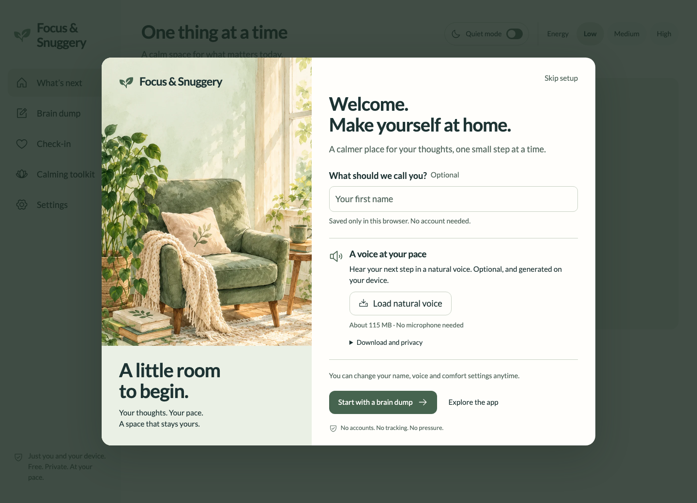
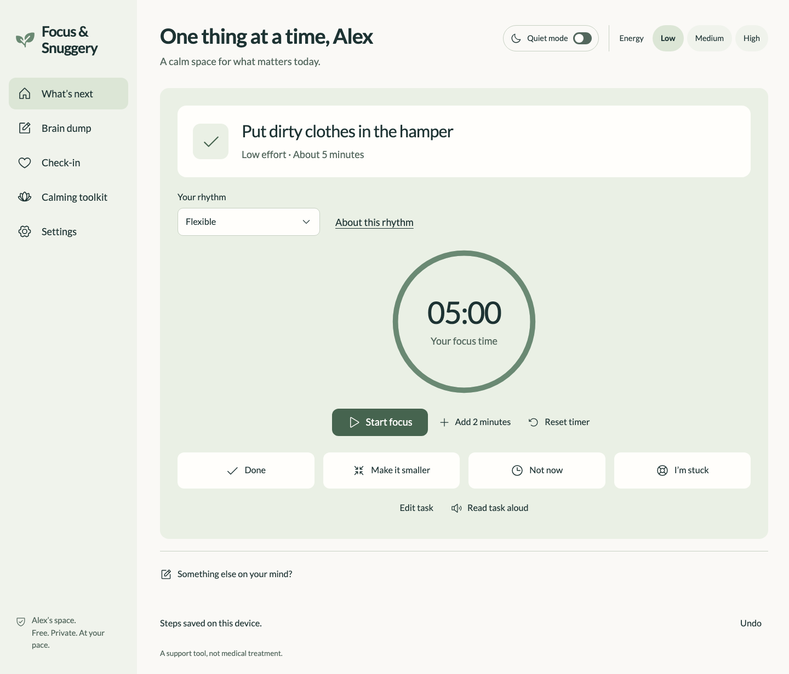

<div align="center">


# Focus & Snuggery

### A little room to begin.

Get a thought out of your head. Turn it into small steps.<br>
Choose one, and take it at your own pace.

**[Open the app](https://sayamdev.github.io/focus-and-snuggery/)** · **[How it works](#from-a-full-head-to-one-small-step)** · **[Run locally](#run-locally)**

Free to use · No account · No tracking · Your data stays in your browser

</div>



## Why this exists

A long to-do list can make starting feel harder. Focus & Snuggery gives you a place to put everything down, review manageable actions, and see one task at a time. There are no streaks to maintain, no missed-day warnings and no pressure to finish a timer.

It is built with cognitive and sensory accessibility in mind. It is a practical support tool, not medical treatment, and its usefulness for different people still needs real-world testing.

## From a full head to one small step

1. **Write or speak a thought.** Start with “clean my room”, or use the microphone to make a short note.
2. **Find small steps.** Press Enter or the button. Shift+Enter adds a new line. Review, edit and reorder the suggestions before saving.
3. **Begin with one thing.** Your next task appears with a flexible timer. Finish, make it smaller, or leave it for later.

Unclear thoughts stay available for clarification. The built-in splitter recognises common everyday tasks; it does not pretend to understand every request. Optional browser AI can help with broader wording, and falls back to the local rules when unavailable.



## Make room for your own pace

| When you need… | What the app offers |
| --- | --- |
| A gentle start | A skippable welcome screen, optional first name and a direct route to your first brain dump |
| Less on screen | One task at a time, quiet mode and simple/detailed views |
| A little structure | Flexible timing, Gentle 10/3 or Pomodoro 25/5; every focus and rest phase starts when you choose |
| Somewhere for a distraction | Park a thought for later without interrupting your timer |
| A moment to pause | A brief check-in, breathing cues and step-by-step five-senses grounding |
| A different way to read | Text sizes, Atkinson Hyperlegible, light/dark/low-sensory/high-contrast themes and reduced motion |
| A voice | Device read-aloud or optional natural speech generated locally with Kokoro |
| A way to speak your note | Local English dictation with Whisper, followed by an editable transcript |
| Control of your data | Local storage, JSON export/import and deletion with undo |

## Voice without uploading your words

Natural read-aloud and dictation are separate, optional downloads. Neither starts automatically.

- **Natural voice:** approximately 115 MB including the model, voice styles and runtime. Choose Emma or George (British English), or Heart (American English), and adjust the pace. Load it in the welcome screen or Settings, then press a read-aloud button.
- **Dictation:** approximately 40 MB plus runtime files. Load the model, allow microphone access, record up to 30 seconds in English, then check the transcript before adding it to your note.
- **Device voice:** uses an installed local English voice without a model download.

Model downloads contact Hugging Face; runtime files come from the app or jsDelivr. Those hosts receive normal download metadata. The application processes task text and recordings on your device. Downloaded resources can be cached; a fresh page requires explicit initialization, and browser storage eviction may require another download. Model removal controls are provided.

Speech recognition can make mistakes. Device capabilities, permissions and available memory affect performance. A simulated microphone with generated speech has been tested end to end; that is not a guarantee for every physical microphone or accent.

## Private by design, with clear limits

Tasks, preferences and check-ins are stored in IndexedDB through Dexie. There is no account, application analytics or server database. GitHub Pages serves the app and receives ordinary hosting requests. Optional AI resource downloads involve the hosts described above.

**Make a backup before clearing browser data.** Data is specific to this browser and site; it does not sync between devices. The current brain-dump draft and focus session are held in the tab, so save steps before reloading. Core features work offline after a successful production load; model downloads need a connection initially.

## Run locally

Requires Node.js 22+ and npm.

```sh
npm ci
npm run dev
```

No API keys, paid services or environment variables are required.

```sh
npm run test                         # Unit and regression tests
npx playwright install chromium     # Once per machine
npm run test:e2e                     # Browser, keyboard and accessibility checks
npm run build                       # TypeScript + production/PWA build
npm run preview                     # Serve the production build
```

## Under the surface

**React · TypeScript · Vite · Dexie · Zod · Transformers.js · Kokoro · WebLLM · Vitest · Playwright**

- Task suggestions are validated before saving; deterministic rules remain available without AI.
- Browser workers keep optional speech inference off the UI thread.
- Focus phases use elapsed time and require explicit starts; reload resets the session.
- Native form controls and a native modal dialog preserve keyboard behavior, with explicit focus handling and readable error states.
- GitHub Actions runs tests and builds before publishing to GitHub Pages.

Accessibility is a development target, not a certification. Automated checks are supplemented by keyboard and responsive testing; human assistive-technology and usability testing remain valuable. See [accessibility notes](ACCESSIBILITY.md).

For architecture, model details, known dependency limits and verification evidence, see [technical notes](docs/TECHNICAL.md), [design decisions](DESIGN.md) and [asset provenance](ASSETS.md).

## Contributing

Bug reports with the browser, device, text-size setting and steps to reproduce are especially useful. Please use fictional example thoughts and omit private recordings or personal exports. Changes should preserve the working offline path, explicit model consent, keyboard access and user control over suggestions.

## Licence

Application code is [MIT licensed](LICENSE). Dependencies, fonts and downloaded models retain their own licences; see [third-party notices](THIRD_PARTY_NOTICES.md). Illustrations were AI-generated for this project.

---

Built by [Sayam Ajmal](https://github.com/SayamDev). A small, calm tool for everyday beginnings.
